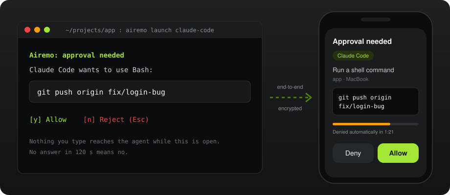
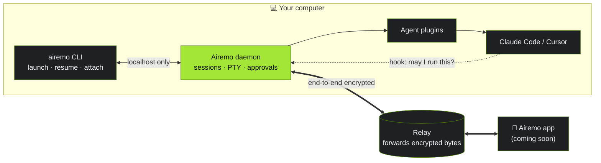
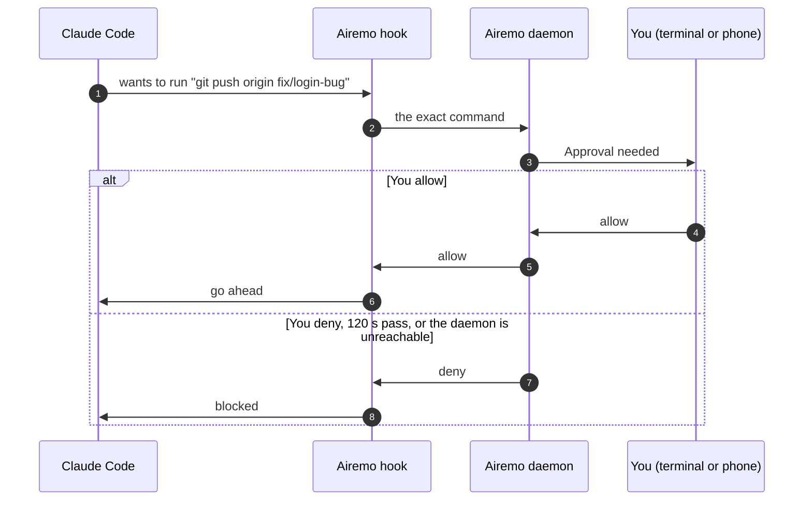

<h1 align="center">
  
</h1>

<p align="center">
  <b>One operating layer for your AI coding agents.</b><br>
  Launch, watch and approve Claude Code and Cursor from your terminal or your phone.<br>
  The agents run on your computer. Your code never leaves it.
</p>

<p align="center">
  <a href="https://github.com/AiRemoLabs/airemo/actions/workflows/ci.yml"></a>
  <a href="LICENSE"></a>
  <a href=".nvmrc"></a>
  <a href="packages/config/tsconfig.base.json"></a>
  <a href="#status"></a>
  <a href="CONTRIBUTING.md"></a>
</p>

<p align="center">
  <a href="QUICKSTART.md"><b>Quickstart</b></a> ·
  <a href="MANUAL.md"><b>Manual</b></a> ·
  <a href="CONTRIBUTING.md"><b>Contributing</b></a> ·
  <a href="packages/plugin-sdk/README.md"><b>Write a plugin</b></a> ·
  <a href="SECURITY.md"><b>Security</b></a>
</p>

<p align="center">
  <br>
  <sub>The terminal prompt works today. The phone app is coming soon.</sub>
</p>

## Why Airemo

AI coding agents are powerful, but each has its own interface and its own permission prompts,
and approving a command means sitting at your desk. Airemo puts one layer above them.

| What you get | How |
|---|---|
| 🛡️ **You approve every action** | The agent's exact command is shown before it runs. No answer means **no**. |
| 📱 **Control from anywhere** | Pair your phone with a QR code, then watch, type and approve away from your desk. |
| 🔒 **Local-first, end-to-end encrypted** | Agents and code stay on your machine. The relay forwards bytes it **cannot read**. |
| 🧩 **One layer, many agents** | One CLI for Claude Code and Cursor today. New agents are plugins, not core changes. |
| 🤝 **Shared sessions** | Your terminal and your phone see the same live session, and either one can answer. |

## Quick start

**You need** Node.js 22+, [pnpm](https://pnpm.io) 11 (`corepack enable`), macOS or Linux, and
Claude Code or Cursor's `cursor-agent` installed and signed in.

```sh
git clone https://github.com/AiRemoLabs/airemo.git && cd airemo
pnpm install && pnpm build
alias airemo="node $PWD/apps/cli/dist/bin.js"   # for this shell; MANUAL.md shows how to keep it

airemo doctor    # which agents did Airemo find?
airemo start     # start the daemon and leave it running
```

In a second terminal, inside your project:

```sh
airemo launch claude-code    # or: airemo launch agent   (Cursor)
```

The agent opens as usual. When it wants to act, Airemo takes over the screen with the exact
command: press **`y`** to allow, **`n`** or **Esc** to reject.

## How it works



| Part | Role |
|---|---|
| **Daemon** | Runs each agent in a real terminal (PTY), streams its screen and holds every permission request until someone decides. Listens on localhost only. |
| **Plugins** | Connect each agent's own hook system to the daemon, so the core never depends on a specific agent. |
| **Relay** | Connects your phone to the daemon across networks. You run it yourself, and it never sees plain text. |

## Approvals



> [!IMPORTANT]
> Airemo launches agents in **ask-first mode**, so an auto-approve setting cannot skip it. It
> asks about what the agent would ask about: explicit allow rules in your agent's own settings
> still let those commands through.

## Supported agents

| Agent | Launch | Approvals | Resume |
|---|---|:---:|:---:|
| **Claude Code** | `airemo launch claude-code` | ✅ | ✅ |
| **Cursor** | `airemo launch agent` | ✅ | ✅ |
| Codex, Gemini CLI, Aider, Goose | | [Write the plugin →](packages/plugin-sdk/README.md) | |

## Status

| Feature | State |
|---|:---:|
| Agents in a real terminal, live streaming, screen restored on reconnect | ✅ |
| Approvals showing the exact command, default-deny | ✅ |
| Full-screen approval prompt in the terminal | ✅ |
| Shared sessions between terminal and phone | ✅ |
| End-to-end encryption (Noise XX) with replay protection | ✅ |
| QR pairing, device list, instant revocation | ✅ |
| Per-folder allowlist of what a phone may start | ✅ |
| Self-hosted relay with device auth, size and rate limits | ✅ |
| Mobile app | 🚧 coming soon |
| Direct LAN connection without a relay | ⏳ planned |
| Web dashboard, shared project plan, orchestrator | ⏳ planned |

## Commands

| Command | What it does |
|---|---|
| `airemo start [--relay wss://…]` | Start the daemon |
| `airemo status` | Daemon, relay and keep-awake state |
| `airemo doctor` | Installed agents |
| `airemo launch <agent>` | New session in this folder |
| `airemo resume <agent> [id]` | Continue an earlier conversation |
| `airemo sessions` / `attach [id]` | List running sessions / join one |
| `airemo allow [path]` / `allowed` / `disallow` | Choose the folders and agents a phone may use |
| `airemo pair` / `devices` / `unpair` | Pair a phone / list devices / cut one off |

Run `airemo --help` for the full guide.

## More

<details>
<summary><b>Remote access: run your own relay</b></summary>

The relay is a small server you host (a `Dockerfile` is in `apps/relay`). It forwards encrypted
frames and cannot read them.

```sh
PORT=8080 node apps/relay/dist/main.js       # 1. the relay
airemo start --relay ws://127.0.0.1:8080     # 2. the daemon, pointed at it
cd path/to/project && airemo allow           # 3. open a folder (nothing is open by default)
airemo pair                                  # 4. QR code: single use, expires in 2 minutes
```

On the internet, put the relay behind TLS and use `wss://`. With a relay, the daemon keeps the
computer from idle sleep so a phone still reaches it with the screen locked (`--no-keep-awake`
turns that off). Step by step: [MANUAL.md](MANUAL.md).

</details>

<details>
<summary><b>Security model</b></summary>

| Risk | Protection |
|---|---|
| A command runs without you | Default-deny: a timeout, agent exit, daemon shutdown or unreachable daemon all mean **no** |
| The relay reads or changes traffic | Noise XX end-to-end encryption; the phone pins the computer's key from the QR code |
| Replayed messages | Every frame carries a counter used as the nonce; approvals are single-use |
| A stranger pairs | Pairing codes work once and expire after 2 minutes; the relay verifies every device key |
| A lost phone | `airemo unpair` cuts it off immediately |
| The phone reaches other folders | Symlink-safe allowlist; errors reveal nothing about your disk |
| A web page talks to the daemon | Loopback only; non-loopback `Host` and unknown `Origin` are refused |
| A disguised command | Control, bidi and invisible characters are shown visibly in the prompt |
| A remote client passes `--dangerously-skip-permissions` | Launch flags are not part of the protocol |

Keys live in `~/.airemo`, readable only by you. Found a problem? Please follow
[SECURITY.md](SECURITY.md).

</details>

<details>
<summary><b>Repository layout</b></summary>

```
airemo/
├── apps/
│   ├── cli/                  the `airemo` command
│   ├── daemon/               sessions, PTY, permission broker, remote hub
│   └── relay/                self-hosted relay for encrypted frames
├── packages/
│   ├── protocol/             message schemas (Zod), shared by every client
│   ├── crypto/               identity, Noise handshake, encrypted channel, pairing
│   ├── client/               reconnecting client for mobile and web
│   ├── plugin-sdk/           the interface every agent plugin implements
│   ├── plugin-claude-code/   Claude Code plugin and permission hook
│   ├── plugin-cursor/        Cursor plugin and approval hook
│   ├── store/                task and project memory (placeholder)
│   └── config/               shared TypeScript config
└── scripts/                  install helpers
```

</details>

## Contributing

Contributions are welcome, and **new agent plugins** are the most wanted.

```sh
pnpm install && pnpm build
pnpm lint && pnpm typecheck && pnpm test
```

1. Read [CONTRIBUTING.md](CONTRIBUTING.md). For a new agent, start with the
   [plugin guide](packages/plugin-sdk/README.md).
2. Open an issue before anything bigger than a small fix.
3. Send your pull request to the **`dev`** branch.

Please report security problems privately through [SECURITY.md](SECURITY.md), not in a public
issue.

## License

| Part | License |
|---|---|
| CLI, daemon, crypto, protocol, client, plugin SDK and plugins | [Apache-2.0](LICENSE) |
| Relay server ([`apps/relay`](apps/relay)) | [FSL-1.1-ALv2](apps/relay/LICENSE): free to use and self-host, no competing hosted service, becomes Apache-2.0 two years after each release |
| Mobile app and web dashboard | Not open source, not in this repository |
